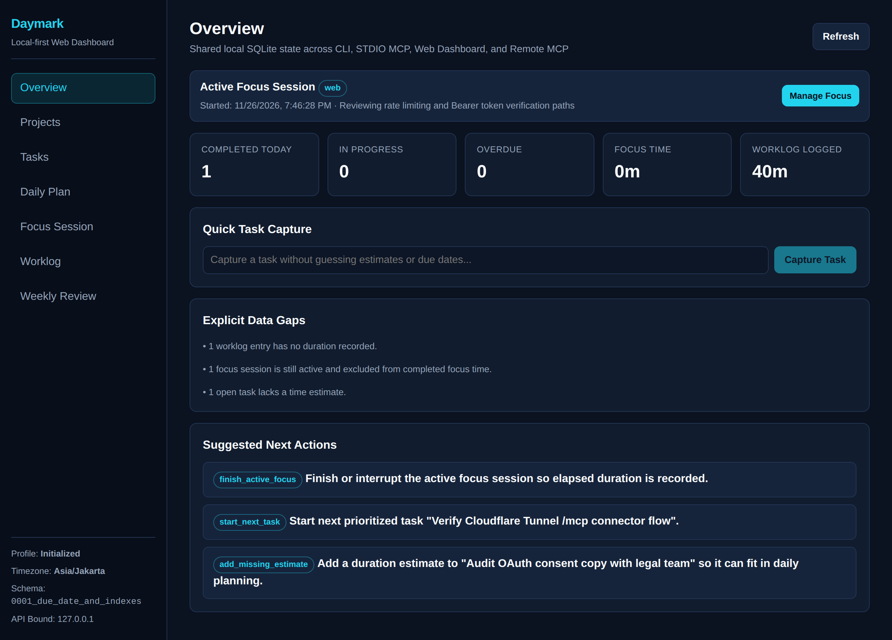
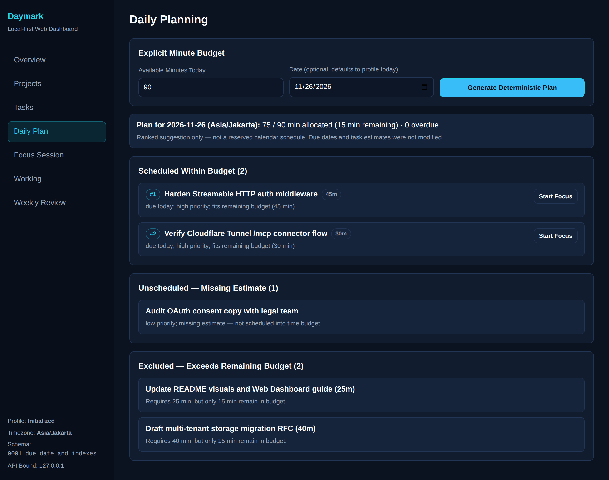
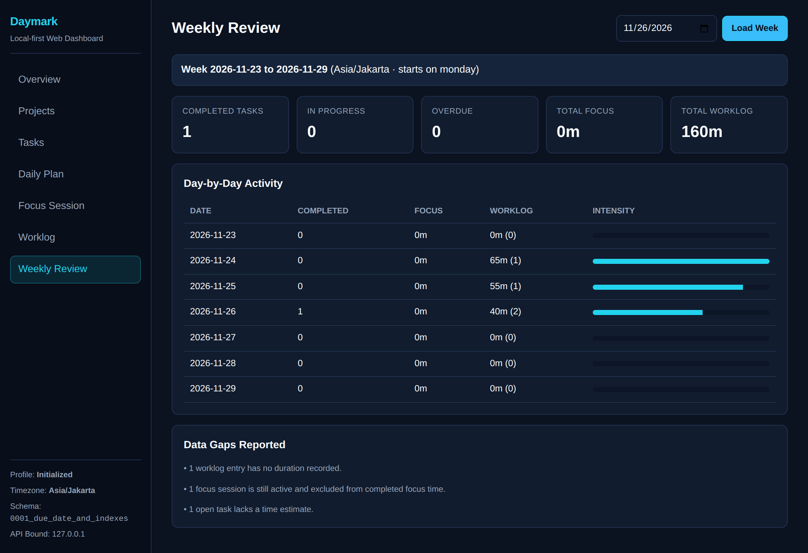
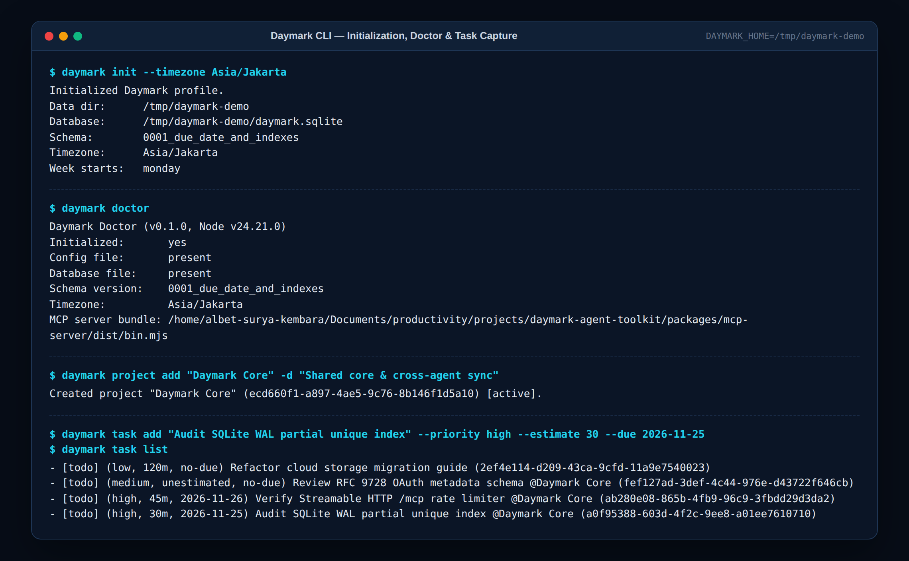
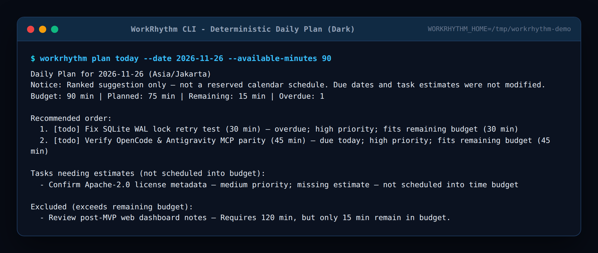
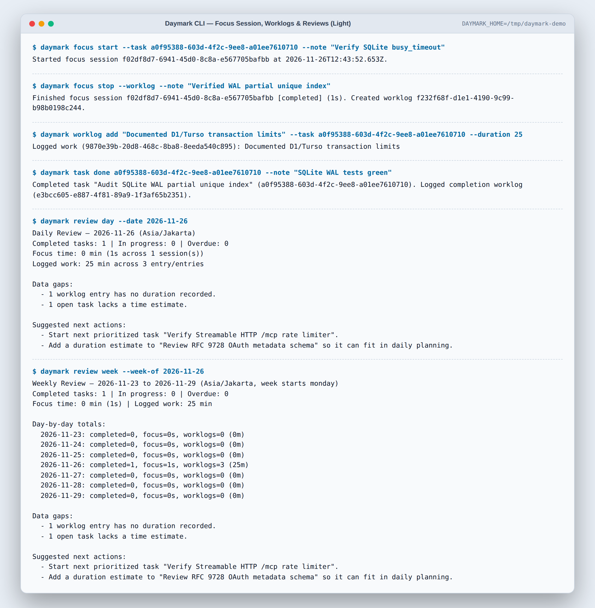
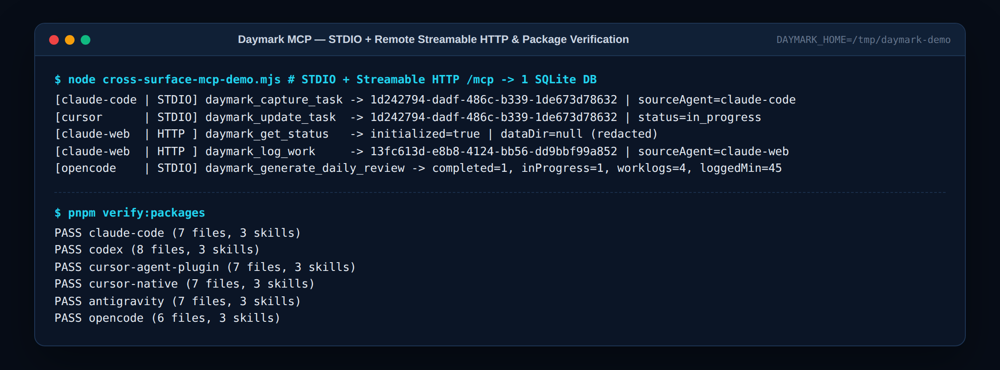
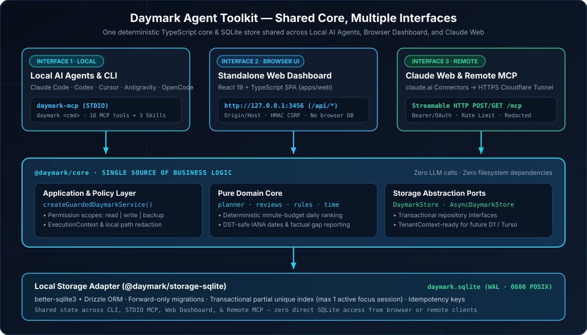

<div align="center">

# Daymark Agent Toolkit

Local-first task, planning, focus, and worklog toolkit built around a **Shared Core** across Local AI Agents (STDIO MCP), a Standalone Web Dashboard (`127.0.0.1`), Claude Web (Remote Streamable HTTP `/mcp`), and a terminal CLI.

[](./LICENSE)
[](./package.json)
[](./tsconfig.base.json)
[](./docs/MCP_CONTRACT.md)
[](./SECURITY.md)

</div>

> **Repository (`daymark-agent-toolkit` / `@daymark/*`):** All user surfaces share one deterministic TypeScript core (`@daymark/core`) and one local SQLite store (`daymark.sqlite`), with centralized scope checks and local path redaction for remote and browser adapters.

---

## Overview

When working across multiple AI coding tools (Claude Code, OpenAI Codex, Cursor, Google Antigravity, OpenCode), **Claude Web**, or a browser UI, tasks and progress notes normally stay isolated inside separate chat histories. Daymark Agent Toolkit follows **Shared Core, Multiple Interfaces**: one `@daymark/core` domain/application engine and one local SQLite database (`daymark.sqlite`) shared across:

1. **Local AI Agents (MCP STDIO)** & **Terminal CLI (`daymark`)**
2. **Standalone Web Dashboard (`apps/web`)** running locally on `127.0.0.1`
3. **Claude Web / Remote Clients (Remote MCP via Streamable HTTP `/mcp`)**

- **Shared local store:** Projects, tasks, daily plans, focus sessions, and worklogs live in one SQLite database (`daymark.sqlite`) located in your OS data directory or `DAYMARK_HOME`.
- **Standalone CLI & Web UI:** Run workflows from the terminal (`daymark`) or the React + TypeScript browser dashboard (`daymark-web`, bound to `127.0.0.1` with Origin + CSRF protection) without requiring an AI model or cloud account.
- **Remote Streamable HTTP MCP (`/mcp`):** Connect Claude Web (`Customize > Connectors > Add custom connector`) over HTTPS via Cloudflare Tunnel using Bearer token or OAuth 2.1 verification, rate limiting, and `read`/`write` permission policies.
- **Deterministic scheduling and reviews:** Task prioritization, minute-budget planning, focus durations, and daily/weekly summaries are computed in TypeScript with no LLM calls.
- **Explicit missing fields:** Unset estimates, due dates, time budgets, and worklog gaps are reported explicitly rather than guessed or rewritten.
- **Local privacy defaults:** Offline SQLite storage with no cloud sync, no telemetry, and no background window, browser, or editor monitoring.

---

## Three Interfaces at a Glance

| Interface | Transport / Entry | Security & Scope Boundary | Shared Storage |
| --- | --- | --- | --- |
| **Local AI Agents & CLI** | `daymark` CLI & `daymark-mcp` (STDIO) | Local OS permissions (`0700` dir, `0600` DB), explicit task/project state transitions | Local SQLite (`daymark.sqlite`) |
| **Standalone Web Dashboard** | React 19 + TS SPA via `127.0.0.1` HTTP `/api/*` | Loopback bind, `Origin`/`Host` validation, HMAC CSRF protection, zero SQLite access in browser | Same SQLite via `@daymark/core` |
| **Claude Web & Remote MCP** | Streamable HTTP `POST/GET /mcp` + Cloudflare Tunnel | Bearer token / OAuth-ready, rate limiting, scope policy (`read` / `write`), local path redaction | Same SQLite via `@daymark/core` |

---

## Screenshots

Real captures from running the live **Web Dashboard** (`127.0.0.1`), **`daymark` CLI**, and **cross-surface MCP adapters** (`STDIO` + `Streamable HTTP /mcp`) against one local SQLite profile:

### Standalone Web Dashboard (Browser UI)

#### 1. Overview — Active Focus, Metrics, Explicit Data Gaps & Next Actions



#### 2. Daily Planning — Deterministic Minute Budget & Excluded Tasks



#### 3. Weekly Review — Activity Intensity & Explicit Data Gaps



### Terminal CLI & Cross-Surface MCP

#### 4. Initialization, Diagnostics (`doctor`), and Task Capture



#### 5. Daily Plan and Unestimated Task Separation



#### 6. Focus Sessions, Worklogs, and Reviews (Light Theme)



#### 7. Cross-Surface MCP Handoff (`STDIO` + `/mcp`) and Package Verification



---

## Architecture



Domain rules reside in `@daymark/core`, persistence resides in `@daymark/storage-sqlite`, and the CLI, STDIO/HTTP MCP adapters, and standalone Web Dashboard invoke shared use cases through `@daymark/core`'s application and policy layer (`createGuardedDaymarkService`) plus storage abstraction ports (`DaymarkStore` and cloud-ready `AsyncDaymarkStore`):

### Monorepo Structure

| Package / Path | Responsibility |
|---|---|
| [`apps/web`](./apps/web) | React 19 + TypeScript Web Dashboard + `127.0.0.1` Node HTTP API (`daymark-web`) with Origin/CSRF protection |
| [`packages/contracts`](./packages/contracts) | Zod v4 schemas, DTOs, typed `DaymarkError` codes, backup archive schema |
| [`packages/config`](./packages/config) | OS data/config paths, `0700`/`0600` permissions, symlink-safe file checks |
| [`packages/core`](./packages/core) | Separated `domain/` (pure planner, reviews, rules, IANA time), `storage/` (`DaymarkStore` + `AsyncDaymarkStore`), and `application/` (use cases + `PermissionPolicy`) |
| [`packages/storage-sqlite`](./packages/storage-sqlite) | `better-sqlite3` + Drizzle ORM schema, forward-only migrations, transactional repositories |
| [`packages/cli`](./packages/cli) | Commander CLI (`daymark`) with human-readable output and `--json` envelopes |
| [`packages/mcp-server`](./packages/mcp-server) | Official MCP TypeScript SDK v2 (`@modelcontextprotocol/server`) supporting STDIO and Streamable HTTP (`/mcp`) |
| [`packages/skills`](./packages/skills) | Frontmatter, tool-parity, and vendor-neutrality validator over [`skills/`](./skills) |
| [`packages/platform-adapters`](./packages/platform-adapters) | Canonical config generator and package verifier (`pack:platforms`, `verify:packages`) |
| [`packages/test-fixtures`](./packages/test-fixtures) | Deterministic tasks, IDs, and DST boundary fixtures |
| [`deploy/cloudflare`](./deploy/cloudflare) | Cloudflare Tunnel config & env templates for Remote MCP (`daymark-mcp --http`) |

---

## Quickstart

### Prerequisites

- Node.js `>= 22.12.0` (tested on Node `v24.21.0`)
- pnpm `12.16.1`

### 1. Install, Build, and Test

```bash
pnpm install --frozen-lockfile
pnpm build
pnpm test
pnpm test:integration
```

To install `daymark`, `daymark-mcp`, and `daymark-web` wrappers locally into `~/.local/bin` without publishing to public npm yet:

```bash
./scripts/install-local.sh
```

See [`docs/RELEASE_STRATEGY.md`](./docs/RELEASE_STRATEGY.md) for the npm `@daymark/*` distribution topology, tarball verification (`pnpm verify:release`), and public registry roadmap.

### 2. Initialize a Local Profile

```bash
# Idempotent; preserves existing config and database records
node packages/cli/dist/bin.mjs init --timezone Asia/Jakarta

# Inspect environment, schema version, and MCP binary readiness
node packages/cli/dist/bin.mjs doctor
```

Default OS locations:
- Linux: `$XDG_DATA_HOME/daymark` (`~/.local/share/daymark/daymark.sqlite`) and `$XDG_CONFIG_HOME/daymark/config.json`
- macOS: `~/Library/Application Support/Daymark/`
- Windows: `%LOCALAPPDATA%\Daymark\`

Override paths via process environment variables when running isolated profiles or tests:
- `DAYMARK_HOME=/path/to/profile`
- `DAYMARK_DATABASE_PATH=/path/to/custom.sqlite`

### 3. CLI Workflow

```bash
# Create a project and capture a task (unset estimate/due fields stay null)
node packages/cli/dist/bin.mjs project add "Core Engine"
node packages/cli/dist/bin.mjs task add "Audit SQLite indexes" --priority high --estimate 45 --due 2026-11-28

# Generate a ranked daily plan for an explicit minute budget
node packages/cli/dist/bin.mjs plan today --available-minutes 90

# Track a focus session and record worklogs
node packages/cli/dist/bin.mjs focus start --task <task-uuid>
node packages/cli/dist/bin.mjs focus stop --worklog --note "Completed index audit"
node packages/cli/dist/bin.mjs worklog add "Reviewed migration scripts" --duration 20

# Complete a task (optionally recording a linked worklog in the same transaction)
node packages/cli/dist/bin.mjs task done <task-uuid> --note "Verified tests"

# Generate daily and weekly reviews with explicit data-gap reporting
node packages/cli/dist/bin.mjs review day
node packages/cli/dist/bin.mjs review week
```

### JSON Output (`--json`)

Every CLI command accepts `--json` for scripting:

- Success (`exit 0`, stdout): `{"ok":true,"data":{...}}`
- Failure (`exit 1`, stderr): `{"ok":false,"error":{"code":"...","message":"...","nextStep":"..."}}`

---

## Standalone Web Dashboard (`apps/web`)

Run the local React + TypeScript dashboard bound strictly to `127.0.0.1`:

```bash
pnpm build
node apps/web/dist/server/bin.mjs --port 3456
# Open http://127.0.0.1:3456 in your browser
```

Includes Overview, Projects, Tasks, Daily Planning, live Focus Session timer, Worklog, and Weekly Review views backed by `@daymark/core` and the same local SQLite database (`Origin` validation + HMAC CSRF protection; zero browser SQLite access).

---

## MCP Server (`daymark-mcp`) — STDIO & Remote Streamable HTTP

The MCP server exposes the 16 tools specified in [`docs/MCP_CONTRACT.md`](./docs/MCP_CONTRACT.md) with Zod v4 validation, `structuredContent`, centralized permission policies, and sanitized `isError` responses. Opt-in diagnostic logs write to `stderr` when `DAYMARK_LOG_LEVEL` is set.

```bash
# Local STDIO transport (default)
node packages/mcp-server/dist/bin.mjs

# Remote Streamable HTTP transport (/mcp) for Claude Web + Cloudflare Tunnel
DAYMARK_MCP_TOKEN="replace-with-random-token" \
DAYMARK_MCP_ALLOWED_HOSTS="daymark-mcp.yourdomain.com" \
node packages/mcp-server/dist/bin.mjs --http --host 127.0.0.1 --port 8787
```

See [`docs/CLAUDE_WEB_INTEGRATION.md`](./docs/CLAUDE_WEB_INTEGRATION.md) for **Claude Web (`Customize > Connectors > Add custom connector`)** setup with Cloudflare Tunnel, and [`docs/CLOUD_ARCHITECTURE.md`](./docs/CLOUD_ARCHITECTURE.md) for tenant isolation and future cloud migration architecture.

| Category | Tool Name | Purpose |
|---|---|---|
| Read | `daymark_get_status` | Initialization state, schema version, timezone, active focus summary |
| Read | `daymark_list_projects` | Paginated project listing (`active`, `archived`, `all`) |
| Read | `daymark_list_tasks` | Filter tasks by status, priority, project, due bounds, or query text |
| Read | `daymark_get_task` | Inspect full task details and related project name |
| Read | `daymark_get_today_plan` | Deterministic daily recommendation for an explicit minute budget |
| Read | `daymark_list_worklog` | Query worklogs and duration totals across a date/time range |
| Write | `daymark_create_project` | Create a project |
| Write | `daymark_update_project` | Rename, update description, or archive/reactivate a project |
| Write | `daymark_capture_task` | Capture a task (supports `idempotencyKey`, reports unspecified fields) |
| Write | `daymark_update_task` | Update explicit task fields or clear nullable fields with `null` |
| Write | `daymark_start_focus` | Start a focus session (enforces max 1 active session transactionally) |
| Write | `daymark_finish_focus` | Finish or interrupt active session and optionally create a worklog |
| Write | `daymark_log_work` | Record an explicit worklog entry (supports `idempotencyKey`) |
| Write | `daymark_complete_task` | Mark task completed and optionally log work in one transaction |
| Review | `daymark_generate_daily_review` | Summarize daily completed, active, and overdue tasks, focus, logs, and gaps |
| Review | `daymark_generate_weekly_review` | Aggregate weekly totals with day-by-day DST-aware breakdown |

---

## Cross-Agent Compatibility (`2026-11-26`)

Generate bundles for all five platforms from the canonical adapter config and check live host tool availability honestly:

```bash
# Portable bundles (uses `daymark-mcp` on PATH)
pnpm pack:platforms

# Local workspace bundles (points directly to packages/mcp-server/dist/bin.mjs)
pnpm --filter @daymark/platform-adapters exec node dist/bin.mjs pack --local

# Verify generated manifests, relative paths, and skills
pnpm verify:packages

# Check host binary availability and run cross-platform matrix checks
pnpm verify:matrix
```

> **Verification policy:** A platform is marked `verified` only after running end-to-end against the real client/app. When a proprietary CLI (`claude`, `codex`, `cursor`) or external cloud account (`claude.ai`) is absent from the build host, status strictly stays `smoke-tested` — see [`docs/PLATFORM_VERIFICATION_EVIDENCE.md`](./docs/PLATFORM_VERIFICATION_EVIDENCE.md).

| Platform | Status | Tier 1 (MCP + Skills) | Tier 2 (Native Bundle) | Verification Notes (`2026-11-26`) |
|---|---|---|---|---|
| Google Antigravity | `verified` | `mcp_config.json` + `skills/` | `.antigravity-plugin/plugin.json` | Installed via `agy plugin install`, passed `agy plugin validate --strict --json` (`agy 1.5.17`), and ran live prompt creating project and task via MCP. |
| OpenCode | `verified` | `opencode.json` + `.opencode/skills/` | `opencode.json` (`mcp.servers.daymark`) | Validated via `opencode debug config` (`opencode v2.2.5`) and ran `opencode --standalone run` updating Antigravity's task, logging work, and generating a daily plan on the shared DB. |
| Standalone Web Dashboard | `verified` | `127.0.0.1` HTTP API + React SPA | Built `apps/web` server + Vite bundle | Verified Origin/Host checks, HMAC CSRF protection, and live Chromium renders across Overview, Daily Plan, and Weekly Review views. |
| Claude Code | `smoke-tested` | `.mcp.json` + `skills/` | `.claude-plugin/plugin.json` | Manifest validated and `.mcp.json` tested via `StdioClientTransport` against shared SQLite DB (`claude` CLI absent on build host). |
| OpenAI Codex | `smoke-tested` | `config.toml.snippet` + `skills/` | `.codex-plugin/plugin.json` + `.mcp.json` | Manifest validated and `.mcp.json` tested via `StdioClientTransport` against shared SQLite DB (`codex` CLI absent on build host). |
| Cursor | `smoke-tested` | `mcp.json` + `skills/` | `cursor-agent-plugin/` & `cursor-native/` | Manifest validated and `mcp.json` tested via `StdioClientTransport` against shared DB (`cursor` app absent on build host). |
| Claude Web (Remote MCP) | `smoke-tested` | Streamable HTTP `/mcp` + Cloudflare config | RFC 9728 OAuth metadata + Bearer policy | Local `/mcp` + `StreamableHTTPClientTransport` integration tests pass; live `claude.ai` UI registration requires an external Anthropic account + HTTPS tunnel. |

<details>
<summary>Platform setup commands (Antigravity, OpenCode, Claude Code, Codex, Cursor)</summary>

```bash
# Google Antigravity
agy plugin validate --strict ./dist/platforms/antigravity
agy plugin install ./dist/platforms/antigravity

# OpenCode (global or project-local)
opencode mcp add --global daymark -- node "$(pwd)/packages/mcp-server/dist/bin.mjs"
mkdir -p ~/.config/opencode/skills && cp -r dist/platforms/opencode/.opencode/skills/* ~/.config/opencode/skills/

# Claude Code (local plugin test)
claude --plugin-dir ./dist/platforms/claude-code

# OpenAI Codex
# Append dist/platforms/codex/config.toml.snippet into ~/.codex/config.toml
# and copy dist/platforms/codex/skills/* into ~/.codex/skills/

# Cursor
# Copy dist/platforms/cursor-agent-plugin/mcp.json to .cursor/mcp.json
# and dist/platforms/cursor-agent-plugin/skills/* to .cursor/skills/
```

See [`docs/PLATFORM_COMPATIBILITY.md`](./docs/PLATFORM_COMPATIBILITY.md) for manifest layouts and verification criteria.

</details>

---

## Portable Agent Skills

Three vendor-neutral skills live in [`skills/`](./skills):

- [`daily-planning`](./skills/daily-planning/SKILL.md): Checks initialization and timezone, confirms available minutes before planning when unset, and lists unestimated tasks separately from the ranked budget.
- [`daily-wrap`](./skills/daily-wrap/SKILL.md): Summarizes recorded daily progress, reports missing worklogs and data gaps, and confirms before marking tasks completed.
- [`task-triage`](./skills/task-triage/SKILL.md): Captures explicit tasks without guessing estimates or due dates, and queries existing tasks before editing to avoid duplicates.

Prompt evaluation test cases are documented in [`packages/skills/EVAL_CHECKLIST.md`](./packages/skills/EVAL_CHECKLIST.md).

---

## Backups, Security, and Uninstall

### Backups, Integrity Checks, and Migrations

Export a backup before running schema upgrades, check SQLite integrity with `daymark doctor`, and follow [`docs/DISASTER_RECOVERY.md`](./docs/DISASTER_RECOVERY.md) if corruption recovery is needed:

```bash
# Export a versioned JSON backup (0600 permissions on POSIX)
node packages/cli/dist/bin.mjs export ./daymark-backup.json

# Verify database integrity (detects DATABASE_CORRUPT cleanly without data loss)
node packages/cli/dist/bin.mjs doctor

# Validate schemas, IDs, relationships, and conflicts without mutating the DB
node packages/cli/dist/bin.mjs import ./daymark-backup.json --dry-run --mode replace

# Restore destructively (explicit --confirm flag required)
node packages/cli/dist/bin.mjs import ./daymark-backup.json --mode replace --confirm
```

### Security and Privacy

- Owner-only POSIX permissions (`0700` directories; `0600` database, config, and backups).
- Symlink traversal blocked on config and backup file I/O; import payloads capped at 50 MiB.
- MCP exposes no raw SQL, filesystem path, shell execution, or network proxy tools.
- Opt-in diagnostic logs (`DAYMARK_LOG_LEVEL=debug`) write to `stderr` only and redact task titles, descriptions, notes, and worklogs.
- Threat model details: [`SECURITY.md`](./SECURITY.md).

### Uninstall

Removing the CLI, MCP entries, or platform plugins leaves your SQLite database untouched. To delete stored local data, remove your Daymark data directory (`~/.local/share/daymark/` on Linux, `~/Library/Application Support/Daymark/` on macOS, `%LOCALAPPDATA%\Daymark\` on Windows, or your custom `DAYMARK_HOME`).

---

## Development and Verification

```bash
pnpm lint               # Biome lint and import checks across packages/ and apps/
pnpm format:check       # Biome formatting check
pnpm typecheck          # Build all 10 workspace projects (9 packages + apps/web) and run tsc --noEmit
pnpm test               # Unit tests (Vitest --project unit)
pnpm test:integration   # SQLite corruption/recovery/shutdown, CLI e2e, Web API/CSRF, MCP STDIO/HTTP, and cross-surface integration tests
pnpm pack:platforms     # Build platform bundles in dist/platforms/
pnpm verify:packages    # Validate generated manifests, relative paths, and skills
pnpm verify:release     # Pack all 9 publishable @daymark/* tarballs and validate resolved dependencies + binaries
pnpm verify:matrix      # Detect host agent CLIs and validate cross-platform matrix status without premature claims
```

---

## License

Apache License 2.0. See [`LICENSE`](./LICENSE).
